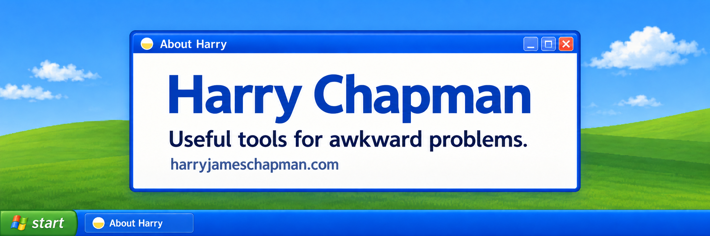

# Hi, I'm Harry

I work on a digital therapeutic in the NHS and build tools around problems I run into—finding scattered information, making decisions with other people, or getting existing software to do something it couldn't before.

I'm interested in practical AI implementation: working out where it helps, building something people can try, and improving it through feedback. I'd like to do more of that in a role involving rapid prototyping and helping teams put useful tools to work.

This GitHub is where I work through those ideas, share what I've learned, and occasionally get distracted by a duck race.

My website, [harryjameschapman.com](https://harryjameschapman.com), is a mid-2000s desktop packed with easter eggs and old features recreated properly. Have a look at Paint.

## Tools and projects

**NHS Evidence Scraper**  
Finding board papers means checking lots of separate websites. This brings document discovery into one local tool. The AI analysis features are still experimental and unverified.  
[Code and sample output](https://github.com/HazzJC/NHSTrustPaperScraper)

**Accessible Palettes**  
A tool for making colour palettes and checking their WCAG contrast, so you can see which combinations work together.  
[Try it](https://hazzjc.github.io/AccessiblePalettesWCAGColourPaletteGenerator/) · [Code](https://github.com/HazzJC/AccessiblePalettesWCAGColourPaletteGenerator)

**G-Helper fork**  
My laptop's keyboard lighting wasn't supported, so I investigated the hardware and added controls to an existing open-source tool. Tested on my ZenBook Pro 16X.  
[Code and working notes](https://github.com/HazzJC/g-helper-ZenBookPro16X-UX7602)

**Let's Play Games**  
Coordinating a group means finding both a time and something everyone wants to do. This helps friends compare their availability and game libraries.  
[Try it](https://what-should-we-play-chi.vercel.app) · [Code](https://github.com/HazzJC/WhatShouldWePlay)

**Ritual**  
A candlelit desk for writing a letter you'll never send, then watching the page burn. An experiment in making a simple interaction feel right.  
[Try it](https://ritual.harryjameschapman.com) · [Code](https://github.com/HazzJC/writeitdownripitup)

## Other experiments

A [Claude Desktop Buddy hardware port](https://github.com/HazzJC/claude-desktop-buddy-waveshare-1-85c) with physical-device validation still to do, a comedy knockout called [Channel 30](https://channel-30.pages.dev), an [esports idle game](https://hazzjc.github.io/esportsidle/), and [LinkMe](https://linkme-5d3.pages.dev/), a quiz for friends.

There's also a [duck race](https://hazzjc.github.io/DuckRaceDecider/) with League of Legends chat, for deciding things.

Profile picture: The Electric State by Simon Stålenhag.
